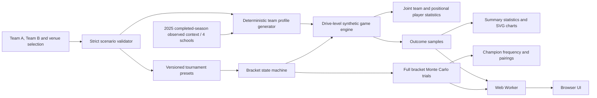
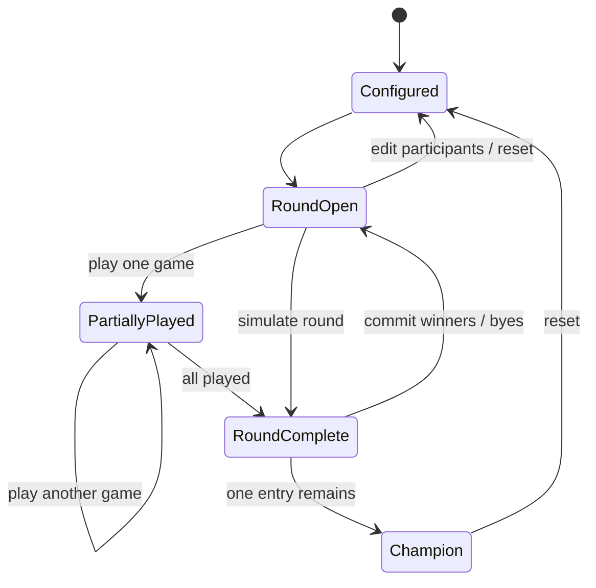

# Architecture and data flow

The implementation uses zero runtime third-party dependencies. HTML5, modern ES modules, CSS, Web Worker, and native SVG avoid a remote CDN or npm install. React/TypeScript/Vite were considered but would introduce unverified dependencies into an internet-restricted build environment. This is an intentional stack deviation, not a React implementation.

## Components

- `src/engine.js`: seeded Mulberry32-like RNG, synthetic ratings and retrospective 2025 descriptive strength proxies for four verified schools, drive outcomes, restrained football score mechanics, consistency-preserving player allocations, game aggregation and statistical summaries.
- `src/tournament.js`: bracket size/seed ordering, pre-set definitions, bye handling, individual games, stage transitions, champion identification, full-bracket Monte Carlo.
- `src/worker.js`: chunked asynchronous simulation with progress and worker termination, no Web Worker network access.
- `src/charts.js`: outcome atlas, two histograms, convergence, generated score timeline, possession atlas and prop histogram.
- `src/observed.js`: manually curated real 2025 athlete identities, school season averages and limited actual matchups; contains no real point-in-time predictive features.
- `scripts/import_ncaa_roster.py`: optional strict CC0 historical dataset ingestion; output remains outside production use until full source validation and a deliberate data refresh.
- `src/app.js`: state machine and accessible UI event delegation; validated fields, selective deep linking, HTML-escaped dynamic strings; no unsafe URL navigation.
- `src/styles.css`: mobile-first two-tab UI with asymmetric editorial layout; reduced-motion rule; accessible focus cues.

## Game logic and limitations

The engine generates each drive's aggregate yards/plays/receiving opportunities, then allocates completions, rushing and receiving yards to synthetic positional roles. Yardage is constrained to match team totals. Regulation has four 900-second quarters and approximate time-consuming drives, but there is **no true down-and-distance play engine**, no penalties, and kick attempts are sampled independently. Overtime uses paired untimed possessions and subsequent synthetic two-point shootouts. This is a simplification, not a fully rules-compliant NCAA overtime implementation.

The RNG is deterministic, not cryptographic and not an anti-cheat mechanism. Client results can be edited by a user. All games are hypothetical local results.

## State machine

## Trust boundaries

All application computations are performed in the end user's browser. Browser inputs and URL-fragment contents are untrusted, validated against the in-bundle team directory and seeded bracket presets. There are no API secrets, cookies, accounts, databases, user-specific server records, or remote JavaScript imports. The host controls TLS, caching, security headers and deployment actions.

## Data contracts

`Team {id:string,name:string,short:string}`. `GameConfig {a,b,seasonA,seasonB,venue,pace,shift,seed} (public UI edits only a, b, venue; others fixed internally)`. `Game {id,seed,config,teams:TeamBox[2],drives:Drive[],final:[number,number],margin,total,winner,ot}`. `Tournament {formatId,participants:string[],seed,slots:(string|null)[],stage,rounds,played,champion,version}`. `TournamentSample {n,counts,probabilities,gamesPlayed,finalMatchups}`. All schemas are validated by code and tested at boundaries; dedicated JSON Schema and DB entity tables have not been implemented.
