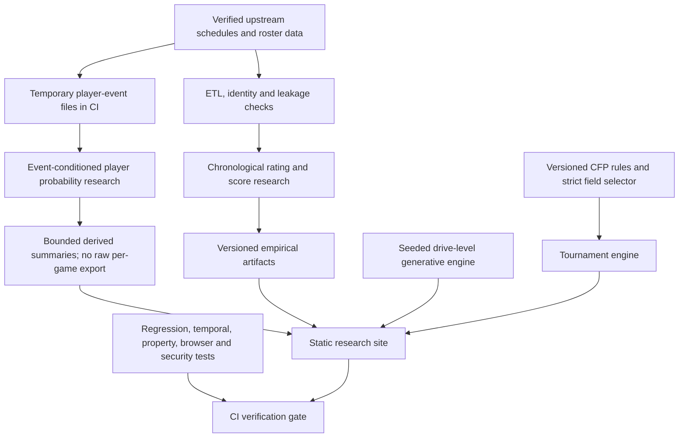

# GRIDIRON LAB v0.8 — Frozen architecture and execution plan

**Planning baseline:** GitHub main at `d69345a109b2ee39662ef66080947f51ff997d2d`, 2026-11-21.
**Baseline results:** 39/39 JavaScript tests, 19/19 Python tests. Static build and remote data refresh to be rechecked.
**Status:** Plan authored before any changes to application, modeling or ingestion code.

## Non-negotiable contracts
1. The core remains static, offline-first, with exactly Game Simulation and Playoff Simulation primary tabs.
2. Matchup controls remain Team A, Team B and venue only.
3. Observed results, empirical baseline forecasts, hypothetical game simulations and athlete-event conditional frequencies are visibly distinct.
4. No private API credentials or bulk raw third-party data in browser or repository. Source-derived public artifacts must be small and meet provider terms.
5. Model claims are justified by chronological evaluation, with 2026 explicitly classified as previously inspected—not a pristine test.
6. Unverified sports rules, starting roles, injury status and current market props cannot be invented.

## Architecture

## Priority / acceptance gates
### Phase A — Freeze and audit
- Verify branch source, baselines, data provenance and CFBD usage rights.
- Record source cutoff, scope and all current controls.
- Preserve previous deployment until tests pass.

### Phase B — Player-model integrity
- Introduce an explainable Beta-Binomial, position/stat-prior event-game frequency estimator.
- For a player: chronological train events only; evaluate later events, report Brier versus prior-only baseline.
- Keep explicit conditioning on a *recorded stat-event game*; no assertion of true active-game opportunity.
- Only expose estimates where effective observations exceed a stated floor.
- Never manufacture full names, starters or unsupported live odds.
- Compare joint QB/team/player reconciliation; block contradictions with tests.

### Phase C — Score simulation validity
- Add replayable ensemble diagnostics for score margin, total and interval coverage.
- Estimate interval widths with training-only data and evaluate on later seasons.
- Separate score-level validation from possession-level calibration, which requires observed drives.
- Strengthen score/quarter/OT and participant accounting invariants.

### Phase D — Official bracket rules
- Build a pure, strict CFP field selector for 2026 12-team and 2027 24-team formats.
- Require explicitly supplied, verified rankings and conference champions; no fabricated CFP committee field.
- Handle Notre Dame top-12 automatic bid only in 2026.
- Keep official bracket geometry independent of field-selection policy.
- Test year-specific bids, seeding, byes, hosts, duplicate rankings and missing champions.

### Phase E — Frontend + security
- Surface a compact provenance/coverage indicator and research table, without adding matchup controls.
- Try native localhost Chromium and WebKit if installed; distinguish emulation from physical iPhone Safari.
- Test URL/input abuse, CSV poisoning, malicious roster HTML, worker cancellation and bracket consistency.
- Verify current GitHub CI and Pages deployment after source upload.

## Release gates
- Unit, Python, build and any executed browser checks pass.
- Each new model reports number of evaluated units, leakage cutoff and baseline.
- Publish an honest `docs/VALIDATION_V08.md` and update `docs/STATUS.md`.
- Do not upgrade pending imports or browser devices to 'verified' without logs.
- Prefer a bounded, traceable release over simulated compliance with every wishlist item.

## Known blockers
- Physical iOS Safari unavailable in this runtime.
- Upstream play-level source requires GitHub Actions downloads; not all raw data is mountable locally.
- 2026 holdout has been examined in earlier iterations.
- Reliable possession-level data / player availability are not verified; no credible claim of fully calibrated joint prop model without them.
