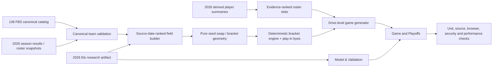

# GRIDIRON LAB 1.0 — Architecture and audit plan (written before implementation)

Frozen baseline: GitHub `main` at commit `2e096908b56b493747b42001eb31ffb2d34f02c9` (confirm before upload). Local source: v0.9.1 release archive. Date: 2026-11-21.

## User-facing contract

1. Keep just three main tabs: Game, Playoffs, Model & Validation. The only Game inputs remain two schools and venue.
2. Playoffs start with **rank-ordered** entrants where 2026 observed Elo ratings are installed. This is a *provisional model ranking, never official CFP committee seeding*.
3. Pre-play swaps exchange seed positions; the field stays unique. Disable swaps once a bracket begins until Reset. Do not silently replace or drop entrants.
4. Support 2, 4, 8, 12, 16, 24, 32, 48, 64, 68, 96, 128 and **all 138 FBS teams**. For 138 teams, 10 preliminary play-in games reduce to 128, while 118 teams receive that round's bye. A single-elimination N-team tournament contains N-1 games including play-ins.
5. Make large brackets approachable: readable seeded field, clearly numbered rounds and regional/paginated fixtures, working game inspectors, clear progress, champion and probabilities.
6. Use **2026 rosters** for roster-linked names in 2026 simulated Game and every playoff game. Prefer 2026 player-event evidence only when matched back to the 2026 roster; never take names from 2025 in the current season. No claim of starter status, injury availability or player-prop calibration.
7. If source ranking/roster artifacts fail, show a prominent evidence/coverage warning and a safe, clearly unranked fallback. Do not invent power ratings or athlete names.

## Architecture and data flow

- `src/research.js`: rank research artifact already verified by 2025 fit / 2026 sequential evaluation; timestamp & coverage must accompany ranking.
- `src/tournament.js`: pure strength-ranked entrants adapter, new full-FBS geometry, swap validation, typed round names, N-1 invariants.
- `src/observed.js`: 2026 roster-only full-name labels, optional matching 2026 derived player-game evidence; fallback is unassigned fictional role.
- `src/app.js`: orchestration; wait for source initialization to seed brackets; inline preflight; paginated accessible bracket explorer; three primary tabs unchanged.
- `src/styles.css`: branded editorial tournament atlas, restrained field geometry and reveal motion; reduced-motion respected, 390px and desktop tested.
- `tests/*`: preserve baseline; add adversarial invariants and seeded player-reconciliation checks.

## Risk boundaries and truth in labeling

- Provisional 2026 Elo seeding is not the official CFP committee ranking, CFP bracket, or retrospective evaluation. It is a game-design default.
- Player-event summaries are conditional on recorded-stat games; this does not verify starters or unconditional future props.
- 2026 rosters were last assembled around 2026-11-21, using mixed primary and weekly sources, with differing school-level cutoffs.
- No subagent orchestration interface is exposed in this Chat session; execute independent quant, rules, frontend, security and reliability review passes with distinct test artifacts instead of claiming fictitious reviewers.
- GitHub Pages static deployment cannot access private credentials or securely proxy paid APIs.

## Acceptance gates

* Exact field sizes and ranked/no-duplicate default order; valid swaps and lock after simulation.
* Full FBS 138 => 137 played games, unique champion, replay determinism and every played match inspectable.
* Live 2026 roster installed in local tests: player names always belong to that season/team; historical evidence match never invents starter roles.
* Mobile bracket uses capped visible fixtures and discoverable view controls, no page-level overflow.
* JS/Python tests, `npm run check`, static build, Playwright Chromium desktop/mobile, and any executable WebKit pass; report skipped environments.
* Security regressions: malicious IDs/HTML, duplicate teams, malformed rankings, invalid seed swaps, worker limits.
* Clearly document achieved verification, as-of data cutoff, known defects, source evidence and rollback.

## Release strategy

Do not mutate `main` until local tests pass; upload all source changes in one commit preserving remote data snapshots. Verify remote branch HEAD and CI/Pages runs after publication. If checks fail, remediate and append a follow-up commit; do not claim a live release without successful deployment.
